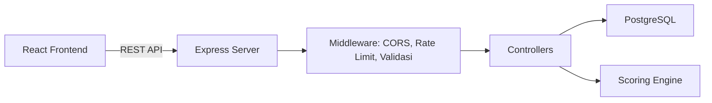
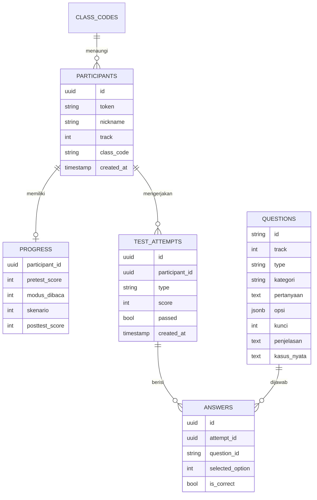

# Rencana Backend TangkisTipu

Dokumen ini merinci rencana pembangunan backend untuk aplikasi edukasi anti-penipuan **TangkisTipu**. Frontend saat ini dibangun dengan React + Vite dan bersifat 100% statis (data di-hardcode di komponen). Backend diperlukan untuk menyimpan progres, menilai tes secara aman, dan memvalidasi kode kelas.

## 1. Ringkasan Stack

| Komponen | Teknologi |
|---|---|
| Runtime | Node.js |
| Framework | Express.js |
| Database | PostgreSQL |
| Validasi | Zod / express-validator |
| Auth | Token anonim (tanpa email/HP) |
| Fokus | MVP: auth token, progres, penilaian tes |

## 2. Analisis Kebutuhan dari Frontend

| Fitur Frontend | Lokasi Kode | Kebutuhan Backend |
|---|---|---|
| Validasi kode kelas | `../frontend/src/components/UjiSkorTes.jsx:4` (`VALID_CODES` hardcoded) | Validasi kode asli dari DB |
| Generate token peserta | `../frontend/src/data/jalurBelajar.jsx:18` (`generateParticipantId()`) | Token dibuat server agar unik & anti-tabrakan |
| Soal pre/post-test | `../frontend/src/data/pretestSoal.jsx` (termasuk `kunci`) | Kunci jawaban tidak boleh dikirim ke klien |
| Penilaian skor | `../frontend/src/components/Pretest.jsx:31` (hitung di klien) | Penilaian server-side (anti-curang) |
| Progres belajar | `../frontend/src/App.jsx:26` (state lokal, hilang saat refresh) | Persistensi progres per token |
| Konten modul | `../frontend/src/data/modul01Pelajar.jsx` (statis) | Opsional: sajikan dari DB agar mudah update |
| Sertifikat & dashboard fasilitator | `../frontend/src/components/DashboardPeserta.jsx` | Fase 2 |

## 3. Arsitektur Sistem



## 4. Skema Database MVP



### Detail Tabel

- **participants**: `id` (uuid, PK), `token` (unik, index), `nickname`, `track` (0-2), `class_code` (nullable), `created_at`.
- **class_codes**: `code` (PK), `label`, `active` (bool), `created_at`.
- **progress**: `participant_id` (FK, PK), `pretest_score` (nullable), `modus_dibaca` (default 0), `skenario` (default 0), `posttest_score` (nullable), `updated_at`.
- **test_attempts**: `id` (uuid, PK), `participant_id` (FK), `type` (`pretest`/`posttest`), `score`, `passed` (bool), `created_at`.
- **answers**: `id` (uuid, PK), `attempt_id` (FK), `question_id` (FK ke questions), `selected_option` (int), `is_correct` (bool).
- **questions**: `id` (string, PK, mis. `R1`/`D1`/`L1`), `track` (0-2), `type` (`pretest`/`posttest`), `kategori`, `pertanyaan` (text), `opsi` (jsonb array string), `kunci` (int, index jawaban benar — **hanya di server**), `penjelasan` (text), `kasus_nyata` (text), `active` (bool), `created_at`.

> Catatan: kolom `kunci` pada tabel `questions` **tidak pernah** dikirim ke klien. Endpoint `start` hanya mengembalikan `id`, `kategori`, `pertanyaan`, dan `opsi`.

## 5. Daftar Endpoint API

### Peserta & Kode Kelas
- `POST /api/participants` — registrasi anonim, generate token unik, validasi kode kelas opsional.
- `GET /api/participants/:token` — ambil profil peserta berdasarkan token.
- `POST /api/class-codes/validate` — validasi kode kelas/komunitas.

### Modul
- `GET /api/modules` — daftar modul.
- `GET /api/modules/:id` — detail konten modul.

### Progres
- `GET /api/progress/:token` — ambil progres peserta.
- `PATCH /api/progress/:token` — perbarui progres (`pretest`, `modusDibaca`, `skenario`, `posttest`).

### Tes
- `POST /api/tests/:type/start` — mulai sesi pre/post-test, kembalikan soal **tanpa kunci jawaban**.
- `POST /api/tests/:type/submit` — kirim jawaban, hitung skor di server, simpan hasil.
- `GET /api/tests/:token/results` — riwayat hasil tes & laporan analisis.

## 6. Aturan Bisnis Penting

- **Keamanan penilaian**: endpoint `start` mengirim soal tanpa field `kunci`; penilaian hanya terjadi di `submit`.
- **Privasi**: sesuai janji UI (tanpa email/HP), token acak adalah satu-satunya kredensial. Wajib ada rate limiting agar token tidak bisa di-brute-force.
- **Kelulusan post-test**: skor >= 8 dinyatakan lulus.
- **Pembatasan percobaan**: post-test hanya 1 kali per set soal untuk penerbitan sertifikat.

## 7. Struktur Proyek Backend (Usulan)

> Folder backend berada di [`Backend/`](../Backend) (sudah tersedia di root workspace, saat ini kosong).

```
Backend/
  plans/            # dokumen rencana (file ini)
  src/
    config/         # koneksi DB, env
    middleware/     # cors, rateLimit, errorHandler, validate
    controllers/    # participants, classCodes, modules, progress, tests
    routes/         # definisi route per resource
    services/       # scoring, token generator
    db/             # migrasi & seed
    app.js
    server.js
  .env.example
  package.json
```

## 8. Rencana Integrasi Frontend

- `../frontend/src/components/UjiSkorTes.jsx` — ganti `VALID_CODES` dengan panggilan `POST /api/class-codes/validate`; token dari `POST /api/participants`.
- `../frontend/src/components/Pretest.jsx` — ambil soal dari `POST /api/tests/pretest/start`; kirim jawaban ke `submit`.
- `../frontend/src/App.jsx` — sinkronkan `progres` state dengan `GET/PATCH /api/progress/:token`.
- `../frontend/src/data/jalurBelajar.jsx` — `generateParticipantId()` dipindah ke server.

## 9. Strategi Migrasi Soal ke Database

Saat ini 30 soal (3 set x 10) berada di [`../frontend/src/data/pretestSoal.jsx`](../frontend/src/data/pretestSoal.jsx) dengan struktur per soal: `id`, `kategori`, `pertanyaan`, `opsi[]`, `kunci` (index), `penjelasan`, `kasusNyata`.

### Langkah Migrasi

1. **Ekstraksi data** — buat script `Backend/src/db/seed-questions.js` yang mengimpor `SOAL_PRETEST_SETS` dari frontend (atau salin sebagai JSON statis) dan memetakan tiap soal ke baris tabel `questions`:
   - `id` ← `soal.id` (mis. `R1`, `D1`, `L1`)
   - `track` ← indeks set (0 = Anak & Remaja, 1 = Dewasa, 2 = Lansia)
   - `type` ← `'pretest'` (post-test menyusul dengan set terpisah)
   - `kategori`, `pertanyaan`, `penjelasan`, `kasus_nyata` ← field terkait
   - `opsi` ← `JSON.stringify(soal.opsi)` (disimpan sebagai `jsonb`)
   - `kunci` ← `soal.kunci` (int, **hanya di server**)
2. **Seed idempotent** — gunakan `INSERT ... ON CONFLICT (id) DO UPDATE` agar aman dijalankan berulang.
3. **Verifikasi** — bandingkan jumlah baris (harus 30) dan cek tiap `track` berisi 10 soal.
4. **Pembersihan frontend** — setelah backend stabil, hapus field `kunci` dari `pretestSoal.jsx` (atau hapus file jika soal sepenuhnya dilayani API) agar kunci tidak lagi ada di bundle klien.
5. **Konten modul** — untuk modul ([`../frontend/src/data/modul01Pelajar.jsx`](../frontend/src/data/modul01Pelajar.jsx)) yang berisi JSX, migrasi ke DB bersifat opsional (Fase 1.5); dapat disimpan sebagai `jsonb` terstruktur atau tetap statis di frontend.

### Format Respons `start` (tanpa kunci)

```json
{
  "attemptId": "uuid",
  "type": "pretest",
  "track": 0,
  "questions": [
    { "id": "R1", "kategori": "...", "pertanyaan": "...", "opsi": ["...", "..."] }
  ]
}
```

## 10. Todo List Eksekusi

- [ ] Tentukan struktur proyek backend di folder Backend/ (konfigurasi env, package.json terpisah)
- [ ] Setup Express server dasar + middleware (CORS, JSON parser, error handler, rate limiter)
- [ ] Konfigurasi koneksi PostgreSQL (pool, migrasi, seed data)
- [ ] Rancang skema database MVP: tabel participants, class_codes, progress, test_attempts, answers, questions
- [ ] Buat script migrasi & seed soal (Backend/src/db/seed-questions.js) dari pretestSoal.jsx ke tabel questions
- [ ] Verifikasi seed: 30 soal (3 set x 10) dengan kunci tersimpan hanya di server
- [ ] Buat endpoint POST /api/participants (registrasi anonim, generate token unik, validasi kode kelas)
- [ ] Buat endpoint GET /api/participants/:token (ambil profil peserta berdasarkan token)
- [ ] Buat endpoint POST /api/class-codes/validate (validasi kode kelas/komunitas)
- [ ] Buat endpoint GET /api/modules dan GET /api/modules/:id (sajikan konten modul dari database)
- [ ] Buat endpoint GET /api/progress/:token dan PATCH /api/progress/:token (simpan progres)
- [ ] Buat endpoint POST /api/tests/:type/start (mulai sesi pre/post-test, kembalikan soal tanpa kunci jawaban)
- [ ] Buat endpoint POST /api/tests/:type/submit (kirim jawaban, hitung skor di server, simpan hasil)
- [ ] Buat endpoint GET /api/tests/:token/results (ambil riwayat hasil tes & laporan analisis)
- [ ] Implementasi logika penilaian server-side (kunci jawaban tidak boleh terekspos ke klien)
- [ ] Implementasi aturan kelulusan post-test (skor >= 8) dan pembatasan 1x percobaan per set
- [ ] Tambahkan validasi input & sanitasi (express-validator/zod) pada semua endpoint
- [ ] Tambahkan dokumentasi API (Swagger/OpenAPI atau README endpoint)
- [ ] Siapkan file .env.example dan dokumentasi cara menjalankan backend
- [ ] Integrasi frontend: ganti data statis dengan panggilan API (UjiSkorTes, Pretest, App progres)
- [ ] Hapus field kunci dari pretestSoal.jsx setelah backend stabil
- [ ] Uji end-to-end alur: registrasi -> simpan kode -> pretest -> belajar modus -> simulasi -> posttest -> hasil
- [ ] (Fase 2) Rancang endpoint sertifikat PDF dan dashboard fasilitator kelompok

## 11. Fase 2 (Menyusul)

- Endpoint pembuatan sertifikat PDF (skor post-test >= 8).
- Dashboard fasilitator kelompok berbasis `class_code` (agregasi skor, progres anggota).
- Autentikasi sederhana untuk fasilitator.
- Analitik & ekspor data kelompok.
